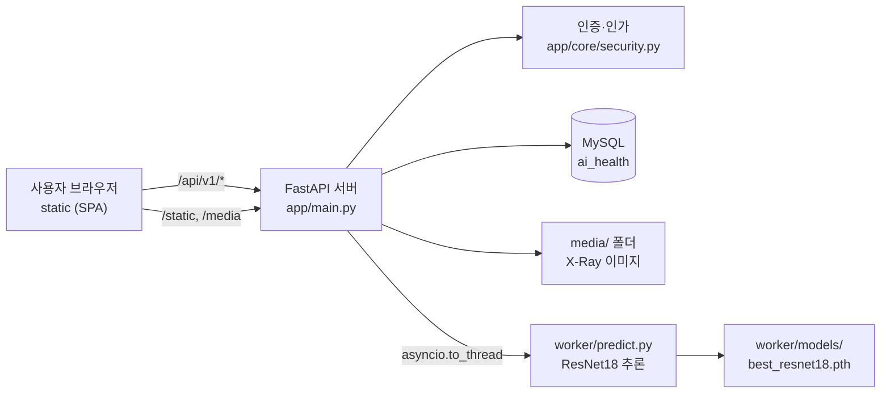
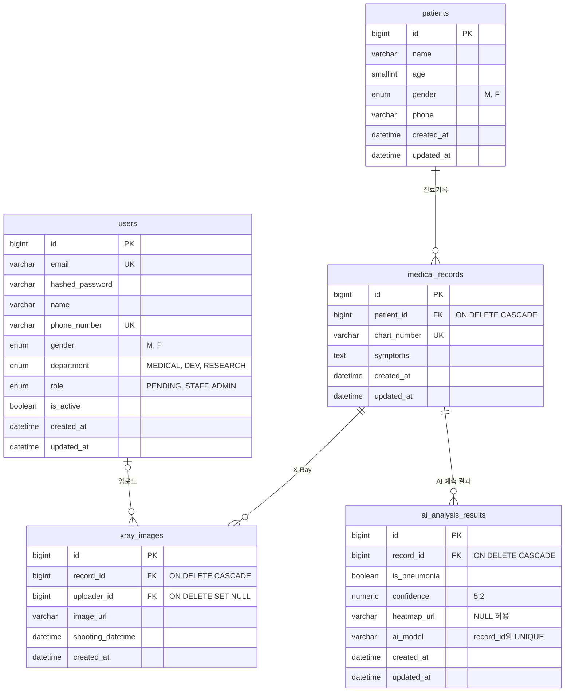
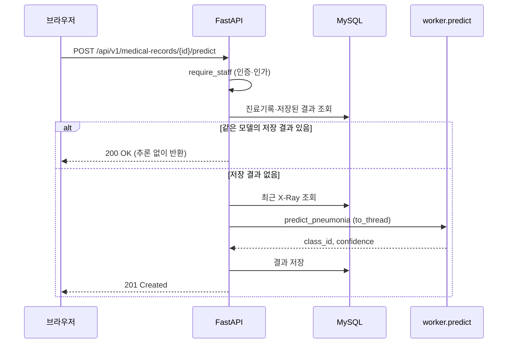

# 🏥 AH_web_development_5team — AI 흉부 X-Ray 폐렴 예측 웹 서비스

병원 내부 직원이 환자·진료기록을 관리하고, 진료기록에 첨부한 흉부 X-Ray 이미지로 **AI 폐렴 예측**을 수행하는 웹 서비스입니다.

| 구분 | 사용 기술 |
|---|---|
| Backend | FastAPI, SQLAlchemy 2.0 (비동기), Pydantic Settings, PyJWT, pwdlib(argon2) |
| Database | MySQL 8.0 (`asyncmy`), Alembic 마이그레이션 |
| AI Worker | PyTorch, torchvision (ResNet18), Pillow |
| Frontend | Vanilla JS + HTML 템플릿 (`static/`) |
| 패키지 관리 | uv (Python 3.13+) |
| 협업 | Git, GitHub (GitHub Flow + Pull Request) |

---

# 🌟 프로젝트 진행 과정 총정리

> 1일차부터 7일차까지 실제로 진행한 단계만 정리했습니다.
> (도커 인프라 구성, AWS 배포, QA는 이번 과제 범위에서 진행하지 않아 제외했습니다.)

| 단계 | 내용 | 진행 시점 | 산출물 |
|---|---|---|---|
| 1 | Team Rule 정의 | 1일차 | `docs/1일차_team_rules.md` |
| 2 | 사용자 요구사항 정의 (읽고 분석) | 1~6일차 | 각 API 명세서의 `REQ-*`, `NFR-*` 항목 |
| 3 | API 명세서 작성 | 4~6일차 | `docs/4·5·6일차_*_API_설계.md` |
| 4 | Git & GitHub Branch 전략 구성 | 2일차 | `docs/2일차_git_branch_전략.md` |
| 5 | 프로젝트 세팅 | 2~3일차 | `app/main.py`, `pyproject.toml`, `alembic/`, `docs/3일차_프로젝트_뜯어보기.ipynb` |
| 6 | API 및 AI 워커 코드 작성 → 브랜치 전략으로 병합 | 3~7일차 | `app/apis/*`, `worker/*`, PR #1 ~ #31 |
| 7 | 아키텍처 설계 및 적용 | 3~6일차 | 계층 구조, DB 스키마(ERD), AI 모델 로딩 구조 |

---

## 1. Team Rule 정의

1일차에 팀원 모두가 부담 없이 협업할 수 있도록 **생활 규칙**과 **Git 규칙**을 함께 정했습니다.

**생활 규칙**
- ⏰ **코어 타임**: 수업 후 오후 3~4시, 1시간 동안 모여 오늘 한 일과 궁금한 점 공유
- 🌱 **1일 1커밋**: 오타 수정, 주석 한 줄도 소중한 기록 — 부담 없이 내 브랜치에 커밋
- ☁️ **쿠션어 사용**: "해주시면 정말 큰 도움이 될 것 같아요!"처럼 부드럽게 소통
- 📢 **편한 회의**: 마이크 켜고, 사소한 아이디어도 환영

**Git 규칙**
- `main`에는 직접 작업하지 않고 **개인 작업 브랜치**에서 작업
- 커밋 메시지는 `feat:`, `fix:`, `docs:` 등의 접두사로 짧고 알기 쉽게 작성
- 작업이 끝나면 PR을 올려 공유하고, 리뷰에는 칭찬과 응원 한마디 남기기

## 2. 사용자 요구사항 정의

이번 과제에서는 요구사항 정의서를 **직접 작성하지 않고 제공된 문서를 읽고 분석**했습니다. (앞으로는 직접 작성해야 합니다.)
각 요구사항에 ID를 붙여 이후 API 명세서·커밋 메시지·PR 제목까지 같은 ID로 추적할 수 있게 했습니다.

| 도메인 | 기능 요구사항 | 비기능 요구사항 |
|---|---|---|
| 회원(User) | `REQ-USER-001~009` 회원가입, 로그인, 로그아웃, 회원 목록·권한 변경, 마이페이지, 정보 수정, 비밀번호 변경, 탈퇴 | `NFR-USER-001` 인증·인가, `NFR-USER-002` 비밀번호 보안, `NFR-USER-003` API 성능 |
| 환자(Patient) | `REQ-PTNT-001~005` 환자 등록·목록·상세·수정·삭제 | `NFR-PTNT-001` 3초 이내 응답 |
| 진료기록(Medical Record) | `REQ-MDR-001~003` 진료기록 등록(X-Ray 업로드)·목록·상세 | `NFR-MDR-001` 3초 이내 응답 |
| AI 예측(Prediction) | `REQ-PRED-001` 폐렴 예측 수행, `REQ-PRED-002` 예측 결과 조회 | `NFR-PRED-001` 모델 평가 기준(Recall ≥ 0.90, Accuracy ≥ 0.80), `NFR-PRED-002` 3초 이내 응답 |

## 3. API 명세서 작성

요구사항을 바탕으로 도메인별 **통합 API 설계 명세서**를 작성하고, 구현 전에 팀원 간 합의를 거쳤습니다.

| 일차 | 문서 | 주요 내용 |
|---|---|---|
| 4일차 | [`USER_API_설계.md`](docs/4일차_USER_API_설계.md) | 회원 API 10개, JWT 토큰 정책(Access/Refresh), 쿠키 보안, 권한(`ADMIN`/`STAFF`/`PENDING`) |
| 5일차 | [`환자관리_API_설계.md`](docs/5일차_환자관리_API_설계.md) | 환자·진료기록 API 8개, 담당자(A~D) 분배, 페이지네이션 규칙, 부서(`MEDICAL`) 기반 권한 |
| 6일차 | [`AI_폐렴예측_API_설계.md`](docs/6일차_AI_폐렴예측_API_설계.md) | 예측 수행·결과 조회 API(`STAFF`·`ADMIN`, 부서 무관), 모델 연동 인터페이스(`worker/predict.py`), 모델 평가 기준 |

**명세서 공통 작성 방식**
- 개요 → 공통 규칙(Enum, 공통 에러 응답 포맷, 데이터 정의) → API 목록 → API별 요청/처리/성공·오류 응답 순서로 통일
- 인증·환자·진료기록·AI 예측 API는 모두 `/api/v1` prefix 사용 (연습용 API와 `/healthcheck`는 제외)
- 마지막에 **비즈니스 규칙 요약 / 구현 시 확인 사항 / 미확정 사항 / 변경 이력** 섹션을 두어 문서를 계속 갱신
- 구현 중 정책이 바뀌면 명세서부터 수정 후 코드에 반영
  (예: *STAFF가 부서를 변경하면 `PENDING`으로 전환* 정책 → PR #22로 명세서 반영)

---

## 4. Git & GitHub Branch 전략 구성

2일차에 팀원들이 각자 조사한 **Git Flow**와 **GitHub Flow**를 하나의 문서로 통합하고, 우리 팀 과제에 맞는 전략을 정해 실제 개발에 적용했습니다.
정리 문서: `docs/2일차_git_branch_전략.md`

### 4.1 두 전략 비교

| 구분 | Git Flow | GitHub Flow |
|---|---|---|
| 기본 구조 | `main`·`develop` + `feature`·`release`·`hotfix` | `main` + 기능·수정별 작업 브랜치 |
| 기능 완료 후 병합 | 주로 `develop` | PR로 `main` |
| 출시 준비 | 별도 `release` 흐름 | 필수 릴리스 브랜치 없음 |
| 장점 | 출시와 개발 단계의 명확한 분리 | 단순함, 빠른 통합과 리뷰 |
| 단점 | 운영 및 학습 부담 | 기준 브랜치(`main`) 품질 관리가 특히 중요 |
| 적합한 환경 | 정기 릴리스·엄격한 출시 관리 | 소규모 팀·지속적 통합 |

### 4.2 우리 팀의 선택: GitHub Flow

<!-- 확인 필요: 수정한 docs/2일차_git_branch_전략.md(4.1 최종 선택 반영)를 main에 반영했는지 -->

**선택 이유**
- 이번 과제의 핵심이 `브랜치 생성 → 개발 → Push → PR → Review → Merge` 흐름을 직접 경험하는 것이다.
- 별도로 출시 버전을 관리하지 않으므로 브랜치 수가 적은 방식이 이해와 운영에 유리하다.
- 짧은 기간 안에 여러 API를 도메인별로 나누어 병렬 개발해야 하므로, 짧은 작업 브랜치를 PR로 바로 `main`에 합치는 방식이 맞다.

**작업 흐름**

```text
main 최신화 → 작업 브랜치 생성 → 개발·Swagger 테스트 → Commit·Push
→ Pull Request → 리뷰 → main에 Merge → 작업 브랜치 정리
```

코드 리뷰와 승인은 GitHub 코멘트 대신 **화상회의와 디스코드**에서 함께 코드를 보며 진행했고, 승인 후 PR을 병합했습니다.

PR을 올리기 전에는 최신 `main`을 작업 브랜치에 먼저 반영해 충돌을 줄였습니다.

```bash
git switch feat/patient-write
git fetch origin
git merge origin/main
```

### 4.3 운영 규칙

| 항목 | 규칙 |
|---|---|
| `main` | 직접 작업하지 않고, PR을 통해서만 병합 |
| 브랜치 | 기능·수정 단위의 짧은 작업 브랜치 (예: `feat/user-api`, `fix/frontend-api-integration`, `docs/api-design`) |
| 커밋 메시지 | `feat:`, `fix:`, `docs:`, `refactor:`, `chore:` 접두사 + 요구사항 ID (예: `feat: 환자 정보 등록·수정·삭제 API 추가 (REQ-PTNT-001, 004, 005)`) |
| PR | 작업 내용 · DB 마이그레이션 · 변경 참고 · 테스트 · 이후 작업 순서로 본문 작성 |
| 리뷰 | 화상회의·디스코드에서 코드를 함께 확인하고 승인한 뒤 병합 |
| 충돌 | 충돌 표시를 직접 정리하고 테스트한 뒤 커밋. `main`에 강제 Push하지 않음 |
| 담당 | 도메인·기능 단위로 담당자를 나누어 브랜치 1개당 1개 기능 (환자 등록·수정·삭제 / 환자 조회 / 진료기록 등록·목록 / 진료기록 상세 등) |

> **팀 규칙과 실제의 차이:** 1일차 팀 규칙은 `feature/이름-기능` 형태였지만, 실제로는 이름 없이 **작업 유형 + 기능** 형태(`feat/`, `fix/`, `docs/`, `refactor/`)가 주로 쓰였고 초기에는 `feature/`와 `feat/`가 섞여 있었습니다.

### 4.4 실제 운영 기록

PR #1부터 순서대로 기능 단위로 병합했습니다.

<!-- 확인 필요: 날짜는 GitHub 커밋 목록 기준 대략값 -->

| 시기 | PR | 주요 내용 |
|---|---|---|
| 10/21~22 | #1~#4 | 1일차 팀 규칙(#1), Git 전략 문서 수정(#2), practice API(#3), 라우터·`main.py` 설정(#4) |
| 10/23 | #5~#11 | 진입점 통일(#5), 3일차 문서(#6), 환자·진료기록·X-Ray·AI 결과 모델(#7, #8), User 모델(#9), 초기 마이그레이션(#10), DB 스키마 문서(#11) |
| 10/26~27 | #12~#19 | User·관리자 API(#12, #13), 5일차 명세서(#14), 공통 보안 모듈 분리(#15), 환자 조회(#16)·등록·수정·삭제(#17), 진료기록 조회(#18)·등록(#19) |
| 10/28 | #20~#28 | 진료기록 상세 명세 맞춤(#20), 프론트–API 통합(#21), 부서 변경 정책 반영(#22), AI 예측 API(#23, #28), 6일차 설계(#24, #26), 모델 평가(#27) |
| 10/29~ | #29~#31 | AI 예측 결과 목록 API·프론트 연동(#29, REQ-PRED-002), 마이페이지 응답에 user id 추가(#30), 7일차 앱 실행 화면 캡처 문서(#31) |

### 4.5 겪은 문제와 해결

1. **README 병합 충돌 (10/21)**: 여러 명이 같은 README를 수정해 충돌이 났고, 충돌 표시를 직접 정리해 해결했습니다(`Resolve README merge conflict`). 이후 README처럼 모두가 건드리는 파일은 담당자를 정해 수정하기로 했습니다.
2. **공통 모듈을 뒤늦게 분리 (PR #15)**: 담당자별로 API를 병렬 개발하다 보니 인증·검증 코드가 중복되고 Timestamp 기본값 버그도 있었습니다. `security`, `validators`를 공통 모듈로 분리하고 모든 파트가 `require_staff` 등을 같이 쓰도록 통일했습니다.
3. **명세서·백엔드·프론트 불일치 (PR #20, #21)**: Swagger에서는 정상인데 실제 화면에서는 회원가입·로그인·로그아웃, 성별·부서 값, 진료기록 상세가 실패했습니다. 프론트의 API 경로·요청 형식·값을 명세서에 맞춰 수정했습니다.
4. **권한 우회 발견 (PR #21, #22)**: STAFF가 마이페이지에서 부서를 `MEDICAL`로 바꿔 환자를 등록할 수 있었습니다. "부서 변경 시 `PENDING`으로 전환" 정책을 **명세서에 먼저 반영(PR #22)** 한 뒤 코드를 수정했습니다.

<!-- 확인 필요: PR #23과 #28의 본문(REQ-PRED-001, predict API)이 동일함. #28 "Files changed"를 확인해 중복 구현이었다면 아래 문장을 5번 사례로 추가. 6일차 문서도 #24·#26(병합)과 #25(병합 없이 닫힘)가 같은 제목이라 같은 사례로 쓸 수 있음
5. **같은 기능의 PR 중복 (PR #23, #28)**: AI 예측 API를 두 PR에서 각각 올려 병합 시 main 반영과 충돌 정리가 한 번 더 필요했습니다. 이슈로 담당자를 먼저 지정하고 시작 전에 공유하기로 했습니다.
-->

### 4.6 회고

| 구분 | 내용 |
|---|---|
| 잘한 점 | PR 단위로 병합해 기능별 이력이 남았다 · 커밋·PR에 요구사항 ID를 붙여 추적할 수 있었다 · PR 본문에 "머지 후 `alembic upgrade head` 필요"처럼 후속 작업을 적었다 · 정책이 바뀌면 명세서부터 수정했다 |
| 아쉬운 점 | 브랜치 이름 규칙이 지켜지지 않았다 · `upload` 같은 의미 없는 커밋 메시지가 일부 있었다 · 화면 통합 테스트가 10/28에야 이루어져 프론트 오류가 늦게 발견됐다 · 리뷰·승인이 화상회의·디스코드에서 이루어져 GitHub PR에는 기록이 남지 않았다 |
| 파이널 프로젝트에서 | 브랜치 이름 규칙을 PR 템플릿에 넣기 · 이슈로 담당자 지정 후 시작 · 공통 모듈과 명세서를 먼저 확정 · 중간 통합 테스트를 일정 앞쪽에 배치 · PR에서 Approve·코멘트로 리뷰 기록 남기기 |

---

## 5. 프로젝트 세팅

2~3일차에 코드를 작성하기 전, 팀원 모두가 **같은 환경과 같은 뼈대** 위에서 개발할 수 있도록 개발 환경, 설정, DB, 마이그레이션을 먼저 갖췄습니다.
참고 문서: `docs/3일차_프로젝트_뜯어보기.ipynb`

### 5.1 세팅 항목

| 항목 | 내용 | 위치 |
|---|---|---|
| 패키지·실행 환경 | Python 3.13+, `uv`로 의존성 관리 (FastAPI, SQLAlchemy 2.0 비동기, `asyncmy`, Alembic, Pydantic Settings, PyJWT, pwdlib, Pillow, PyTorch) | `pyproject.toml`, `uv.lock` |
| 설정 관리 | `.env`로 DB·JWT·모델 이름 등 관리, `pydantic-settings`로 로드. `.env`는 Git에 올리지 않고 `.env.example`만 공유 | `app/core/config.py`, `.env.example` |
| DB | MySQL 8.0 (docker compose의 `mysql` 서비스), `asyncmy` 비동기 엔진·세션 | `docker-compose.yml`, `app/core/db/databases.py` |
| 모델 | `users`, `patients`, `medical_records`, `xray_images`, `ai_analysis_results` | `app/models/` |
| 마이그레이션 | Alembic: `c75d234c47b0`(초기 테이블) → `a1b2c3d4e5f6`(AI 결과 `heatmap_url` NULL 허용, `(record_id, ai_model)` UNIQUE) | `alembic/versions/` |
| 진입점 | 라우터 등록, 시작 시 AI 모델 로드, 정적 파일·SPA 라우팅 | `app/main.py` |
| 공통 모듈 | 인증·인가, 입력 검증, 파일 저장 | `app/core/security.py`, `validators.py`, `storage.py` |

<!-- 확인 필요: 위 의존성·마이그레이션은 10/29 시점 zip 기준. 최신 main에서 pyproject.toml과 `alembic history`로 확인 -->

### 5.2 세팅 순서

```bash
# 1. 저장소 받기 + 의존성 설치
git clone <저장소 주소>
cd AH_web_development_5team
uv sync

# 2. 환경 변수 설정 (JWT_SECRET_KEY는 필수)
cp .env.example .env

# 3. MySQL 컨테이너 실행 (Docker Desktop이 켜져 있어야 함)
docker compose up -d mysql
docker compose ps   # STATUS가 healthy가 될 때까지 20~30초 대기

# 4. DB 테이블 생성 (프로젝트 루트에서 실행)
uv run alembic upgrade head

# 5. 서버 실행
uv run fastapi dev app/main.py
```

실행 확인
- `http://localhost:8000/docs`: Swagger UI
- `http://localhost:8000/healthcheck`: `{"status": "ok"}`
- `http://localhost:8000/login`: 화면

> **Windows(PowerShell) 사용 시 참고**
> - 프로젝트를 OneDrive 같은 클라우드 동기화 폴더 안에 두면 `uv sync`가 실패할 수 있습니다. OneDrive 밖의 폴더(예: `C:\dev`)에 받거나 `uv sync --link-mode=copy`를 사용하세요.
> - `docker compose` 명령 전에 **Docker Desktop이 실행 중**인지 확인하세요.
> - 3306 포트가 이미 사용 중이면 `.env`의 `DB_PORT`를 `3307`로 바꾸세요. (앱과 Alembic이 같은 `.env`를 읽으므로 따로 수정할 곳은 없습니다.)

> 애플리케이션 컨테이너화(Docker 배포)는 이번 범위에서 제외했고, `docker-compose.yml`은 MySQL 실행에만 사용했습니다.

### 5.3 세팅 중 겪은 문제와 해결

| 증상 | 원인과 해결 |
|---|---|
| `ModuleNotFoundError: No module named 'app'` | 프로젝트 루트가 아닌 곳에서 실행함. `alembic.ini`가 있는 루트에서 실행 |
| 마이그레이션 파일이 비어 있음 (`pass`만 있음) | 모델이 `app/models/__init__.py`에서 import되지 않았거나 `Base`를 상속하지 않음 |
| `Can't connect to MySQL server` | MySQL 컨테이너가 꺼져 있거나 `.env`의 `DB_HOST`·`DB_PORT`가 다름 (로컬 실행 시 `DB_HOST=localhost`) |
| 서버가 시작되지 않음 | `.env`에 `JWT_SECRET_KEY`가 없음 (기본값이 없는 필수 설정) |
| 머지 후 API가 DB 오류 | 새 마이그레이션이 추가됨. 머지한 뒤 `uv run alembic upgrade head` 실행 (PR #23 본문에 명시) |
| `uv sync` 중 `failed to hardlink file ... (os error 396)` ("클라우드 작업은 호환되지 않는 하드 링크가 있는 파일에서 수행할 수 없습니다") | 프로젝트가 OneDrive 동기화 폴더에 있어 uv의 하드 링크 방식이 실패함. `uv sync --link-mode=copy`로 실행하거나 OneDrive 밖의 폴더에서 작업 |
| `failed to connect to the docker API at npipe:////./pipe/dockerDesktopLinuxEngine` | Docker Desktop이 실행되지 않음. Docker Desktop을 켜고 엔진이 시작된 뒤 다시 실행 |
| `Bind for 0.0.0.0:3306 failed: port is already allocated` | 다른 MySQL(예: 기존 프로젝트 폴더의 `...-mysql-1` 컨테이너)이 3306을 사용 중. `docker ps`로 확인해 중지하거나 `.env`의 `DB_PORT`를 `3307` 등으로 변경 |

### 5.4 세팅 과정의 변경 이력

| PR | 내용 |
|---|---|
| #4, #5 | 라우터·`main.py` 설정 후, `app/apis/main.py`를 제거하고 진입점을 `app/main.py`로 통일 |
| #7~#9 | 환자·진료기록·X-Ray·AI 결과·User 모델 작성 |
| #10 | 초기 테이블 마이그레이션 추가, `patients.gender`를 Enum으로 수정 |
| #15 | 인증·검증 공통 모듈 분리, Timestamp 기본값 버그 수정 |
| #23 | AI 결과 테이블 변경 마이그레이션(`a1b2c3d4e5f6`), `AI_MODEL_NAME` 설정 추가 |

---

## 6. API 및 AI 워커 코드 작성 후 Branch 전략을 통한 코드 병합

3~7일차에 도메인·기능 단위로 담당자를 나누어 API와 AI 워커 코드를 작성하고, 4장의 GitHub Flow(작업 브랜치 → PR → 리뷰 → `main` 병합)로 합쳤습니다. 이 장은 그중 AI 폐렴 예측 API와 AI 워커(`REQ-PRED-001`, `REQ-PRED-002`, `NFR-PRED-001`, `NFR-PRED-002`)를 **실제 구현 코드 기준**으로 정리합니다.

### 6.1 담당 범위

| 담당 | 범위 |
|---|---|
| API 담당 | `app/apis/ai_prediction.py`, DB 마이그레이션, 결과 저장·조회, 프론트엔드 연동 |
| 모델(워커) 담당 | `worker/predict.py`, `worker/models/best_resnet18.pth`, 모델 평가 |

두 영역은 `worker.predict`의 `load_model()`, `predict_pneumonia()` 두 함수로만 연결됩니다.

### 6.2 구현한 API

| 요구사항 ID | 기능 | Method | 경로 | 권한 |
|---|---|---|---|---|
| `REQ-PRED-001` | AI 폐렴 예측 수행 | `POST` | `/api/v1/medical-records/{record_id}/predict` | `STAFF`, `ADMIN` (부서 무관) |
| `REQ-PRED-002` | AI 폐렴 예측 결과 목록 조회 | `GET` | `/api/v1/medical-records/{record_id}/analyses` | `STAFF`, `ADMIN` (부서 무관) |

- 라우터는 `/medical-records`만 가지고 있고, `/api/v1`은 `app/main.py`의 `include_router(..., prefix=API_PREFIX)`에서 붙입니다.
- `/api/v1`은 인증·마이페이지·회원 관리·환자·진료기록·AI 예측 라우터에 적용됩니다. 연습용 `practice_router`(prefix 없이 등록), `/healthcheck`, 정적·SPA 경로는 `/api/v1` 밖에 있습니다.
- 인증·인가는 공통 `require_staff`를 사용합니다. `PENDING`은 `403`입니다.
- 에러 응답은 모두 `{"detail": "..."}` 형식입니다.

### 6.3 예측 수행 API 처리 흐름 (`POST .../predict`)

1. `require_staff`로 인증·인가를 확인한다.
2. `record_id`로 진료기록을 조회한다. 없으면 `404` (`진료기록을 찾을 수 없습니다.`).
3. 같은 `record_id`와 현재 모델(`settings.AI_MODEL_NAME`)의 저장된 결과가 있으면 **추론 없이 `200 OK`로 반환**한다.
4. `app.state.model_loaded`가 `False`면 `503` (`AI 모델을 사용할 수 없습니다.`).
5. 진료기록의 가장 최근 X-Ray(`xray_images.id` 내림차순 첫 번째)를 선택한다. 없으면 `404` (`진료기록의 X-Ray 이미지를 찾을 수 없습니다.`).
6. `image_url`(`/media/...`)을 서버의 `media/` 하위 경로로 변환한다. `media/` 밖의 경로는 거부한다.
7. 이미지를 RGB로 읽어 `predict_pneumonia`로 추론한다. 동기 작업이므로 `asyncio.to_thread`로 실행한다. 파일이 없거나 추론에 실패하면 `500` (`AI 예측 중 오류가 발생했습니다.`).
8. 결과를 변환해 `ai_analysis_results`에 저장하고 `201 Created`로 반환한다.
9. 동시 요청으로 UNIQUE 제약 위반(`IntegrityError`)이 나면 롤백한 뒤 먼저 저장된 결과를 `200 OK`로 반환한다. 저장된 결과가 없으면(다른 제약 위반) `500`이다.

**동작 순서 참고:** `503` 확인(4)이 X-Ray `404` 확인(5)보다 먼저이므로, 모델이 로드되지 않은 상태에서는 X-Ray가 없는 진료기록도 `503`이 반환됩니다.

### 6.4 응답 변환 규칙

| `predict_pneumonia` 반환 | API 필드 | 변환 |
|---|---|---|
| `class_id` | `is_pneumonia` | `class_id == 1`이면 `true` (1 = 폐렴, 0 = 정상. 확인 완료) |
| `confidence` (0~1 softmax 확률) | `confidence` | `Decimal`로 ×100 후 소수 둘째 자리 `ROUND_HALF_UP` (0~100) |
| (없음) | `heatmap_url` | 현재 모델은 Heatmap을 만들지 않아 `null` |
| 설정값 | `ai_model` | `settings.AI_MODEL_NAME` (기본값 `resnet18-v1`) |
| `label` | (저장 안 함) | `is_pneumonia`로 대체 |

응답 객체(`AiAnalysisResponse`) 예시:

```json
{
  "id": 1,
  "record_id": 12,
  "is_pneumonia": true,
  "confidence": 93.47,
  "heatmap_url": null,
  "ai_model": "resnet18-v1",
  "created_at": "2026-10-28T03:03:00Z"
}
```

### 6.5 결과 목록 조회 API 처리 흐름 (`GET .../analyses`)

- 진료기록이 없으면 `404`.
- 해당 진료기록의 모든 결과를 `created_at` 내림차순(같으면 `id` 내림차순)으로 반환한다.
- 결과가 없으면 `200 OK`와 빈 배열 `[]`이다.
- 진료기록당 결과 수가 모델 수만큼이라 페이지네이션 없이 배열을 그대로 반환한다.

### 6.6 상태 코드·에러 정리

| 상태 코드 | 상황 | `detail` |
|---|---|---|
| `201` | 새로 추론하여 저장 | (결과 본문) |
| `200` | 저장된 결과 반환(추론 미수행), 동시 요청에서 먼저 저장된 결과 반환 | (결과 본문) |
| `401` | 토큰 누락·만료·유효하지 않음 | 공통 인증 메시지 |
| `403` | `PENDING` 회원 또는 비활성 계정 | `접근 권한이 없습니다.` |
| `404` | 진료기록 없음 | `진료기록을 찾을 수 없습니다.` |
| `404` | X-Ray 이미지 없음 | `진료기록의 X-Ray 이미지를 찾을 수 없습니다.` |
| `422` | `record_id`가 1 미만 등 | FastAPI 기본 형식 |
| `500` | 이미지 파일 읽기 실패, 추론·저장 중 오류 | `AI 예측 중 오류가 발생했습니다.` |
| `503` | 모델이 로드되지 않음 | `AI 모델을 사용할 수 없습니다.` |

### 6.7 AI 워커 코드 (`worker/predict.py`)

| 항목 | 내용 |
|---|---|
| 모델 | torchvision ResNet18 (`weights=None`), `fc = Dropout(0.5) + Linear(512, 2)` |
| 가중치 | `worker/models/best_resnet18.pth` (`torch.load(..., weights_only=True)`) |
| 장치 | CUDA가 있으면 GPU, 없으면 CPU |
| 전처리 | 흑백 3채널 → 224×224 리사이즈 → `ToTensor` → ImageNet 평균·표준편차 정규화 |
| 추론 | `torch.inference_mode()`에서 `softmax` 후 `argmax` (폐렴 확률 0.5 기준) |
| 반환값 | `{"class_id": 0 또는 1, "label": "Normal" 또는 "Pneumonia", "confidence": 예측 클래스 확률(0~1)}` |

**모델 로드 방식**

- `load_model()`은 가중치를 읽어 `eval()` 상태로 전역(`_loaded_model`)에 보관합니다.
- 서버 시작 시 `app/main.py`의 `lifespan`에서 `asyncio.to_thread(load_model)`로 한 번만 호출합니다.
- 로드에 성공하면 `app.state.model_loaded = True`, 실패하면 `False`로 두고 **서버는 계속 실행**합니다. 실패 상태에서는 예측 API만 `503`을 반환합니다.
- `predict_pneumonia` 안에는 `_loaded_model`이 `None`이면 `load_model()`을 호출하는 지연 로드가 남아 있습니다. API는 추론 전에 `model_loaded`를 먼저 확인하므로, API를 통한 요청에서는 이 지연 로드가 실행되지 않습니다. (보조 안전장치)

### 6.8 설정 (`app/core/config.py`)

| 설정 | 기본값 | 설명 |
|---|---|---|
| `JWT_SECRET_KEY` | 없음 (필수) | `.env`에 없으면 서버가 시작되지 않는다 |
| `JWT_ALGORITHM` | `HS256` | |
| `ACCESS_TOKEN_EXPIRE_MINUTES` | `30` | Access Token 30분 |
| `REFRESH_TOKEN_EXPIRE_DAYS` | `7` | Refresh Token 7일 |
| `COOKIE_SECURE` | `False` | HTTPS 환경에서만 `True` |
| `DB_USER`, `DB_PASSWORD`, `DB_HOST`, `DB_PORT`, `DB_NAME` | 로컬 개발용 기본값 (`DB_NAME`은 `ai_health`) | 배포 시 `.env`로 덮어쓴다 |
| `AI_MODEL_NAME` | `resnet18-v1` | `ai_analysis_results.ai_model`에 저장(최대 50자). 모델 평가를 통과한 모델 이름과 같아야 하며, 재학습 시 버전을 올린다(예: `resnet18-v2`) |

`.env.example`에도 `AI_MODEL_NAME=resnet18-v1`이 들어 있어 `config.py` 기본값과 같습니다.

### 6.9 DB 변경 (Alembic 마이그레이션)

마이그레이션 순서: `c75d234c47b0`(초기 테이블, 2026-10-23) → `a1b2c3d4e5f6`(AI 결과 테이블 수정, 2026-10-28)

**`ai_analysis_results` 최종 구조**

| 컬럼 | 타입 | NULL | 비고 |
|---|---|---|---|
| `id` | BigInteger | 아니요 | PK, 자동 증가 |
| `record_id` | BigInteger | 아니요 | FK → `medical_records.id`, `ON DELETE CASCADE` |
| `is_pneumonia` | Boolean | 아니요 | |
| `confidence` | Numeric(5,2) | 아니요 | 0~100 |
| `heatmap_url` | String(255) | **예** | `a1b2c3d4e5f6`에서 NULL 허용으로 변경 |
| `ai_model` | String(50) | 아니요 | |
| `created_at` | DateTime | 아니요 | 기본값 `current_timestamp(0)` |
| `updated_at` | DateTime | 예 | 응답에는 포함하지 않음 |

- UNIQUE 제약 `uq_ai_results_record_model` (`record_id`, `ai_model`): 같은 진료기록·같은 모델의 결과는 1건만 저장하며, 동시 요청 처리(6.3의 9번)가 이 제약에 의존합니다.
- `a1b2c3d4e5f6`의 `downgrade()`는 UNIQUE 제약을 삭제하고 `heatmap_url`을 `NOT NULL`로 되돌립니다. (`heatmap_url`에 `NULL` 행이 있으면 되돌릴 수 없습니다.)
- 입력 이미지는 `xray_images.image_url`(`/media/xray/...`)에서 가져옵니다. 진료기록 삭제 시 `ON DELETE CASCADE`로 결과도 함께 삭제됩니다.

### 6.10 프론트엔드 연동 (`static/pages.js`)

| 위치 | 동작 |
|---|---|
| `renderRecordDetail` | 페이지 진입 시 진료기록 상세와 예측 결과 목록(`getMedicalRecordAnalyses`)을 불러온다. 결과가 없으면 "저장된 예측 결과가 없습니다."를 표시한다. |
| 결과 표 | 수행 일시, 폐렴 여부(`Positive`/`Negative`), `Confidence {값}%`, 사용 모델, Heatmap. `heatmap_url`이 있으면 ``로, 없으면 `-`로 표시한다. |
| `handlePredict` | **AI 예측 결과보기** 버튼 클릭 시 버튼을 비활성화하고 "분석 중..."으로 바꾼 뒤 `predictPneumonia`를 호출한다. 성공(200·201)하면 알림을 띄우고 같은 경로로 `navigate(..., false)`하여 화면을 다시 그린다. 실패하면 오류 알림 후 버튼을 원래대로 복구한다. |

- `static/apis.js`의 `getMedicalRecordAnalyses`는 임시 `try/catch`를 제거하고 `this.request(...)` 결과만 반환합니다. 그래서 `403`·`500` 같은 실제 오류도 화면에 오류로 표시됩니다.
- `static/templates/record-detail.html`에는 별도 Heatmap 표시 영역이 없고, `pages.js` 결과 표의 Heatmap 열로 대신합니다. (명세서 8장의 "템플릿에 Heatmap 영역 추가"와 다른 점)
- `static/app.js`의 `navigate`는 `PENDING` 사용자가 공개 경로 외 페이지에 접근하면 막습니다. 서버의 `403` 정책과 같은 방향입니다.
- 인증은 `localStorage`의 access token과 refresh(`apis.refresh`)로 유지합니다.

### 6.11 7일차 앱 실행 화면 대응

| 번호 | 화면 | Endpoint |
|---:|---|---|
| 17 | 환자별 진료기록 목록 조회 | `GET /api/v1/patients/{patient_id}/medical-records` |
| 18 | 진료기록 상세 조회 | `GET /api/v1/medical-records/{record_id}` |
| 19 | AI 폐렴 예측 수행 | `POST /api/v1/medical-records/{record_id}/predict` |
| 20 | AI 예측 결과 목록 조회 | `GET /api/v1/medical-records/{record_id}/analyses` |

<!-- 확인 필요: docs/7일차_앱_실행화면.md의 17·18·20번이 아직 "실제 구현된 경로 확인 필요"로 남아 있음 → 위 경로로 수정 -->

### 6.12 모델 평가 결과 (`NFR-PRED-001`)

| 항목 | 값 |
|---|---|
| 모델 이름·버전 (`AI_MODEL_NAME`) | `resnet18-v1` |
| Recall (기준 ≥ 0.90) | 0.991 |
| Accuracy (기준 ≥ 0.80) | 0.990 |
| 반영 여부 | 기준 통과 |
| 기록 문서 | `docs/모델평가_resnet18-v1.md` (PR #27) |

평가 데이터 출처·표본 수·혼동 행렬(TP/FP/FN/TN)은 위 기록 문서에 있습니다.

### 6.13 브랜치 전략을 통한 병합

AI 예측 기능도 4장의 GitHub Flow대로 작업 브랜치에서 PR을 올리고, 리뷰·승인 후 `main`에 병합했습니다. 병합 전에는 최신 `main`을 작업 브랜치에 먼저 반영해 충돌을 줄였습니다. 관련 PR은 다음과 같습니다.

| PR | 내용 |
|---|---|
| #23, #28 | AI 폐렴 예측 API (`REQ-PRED-001`), AI 결과 테이블 변경 마이그레이션(`a1b2c3d4e5f6`), `AI_MODEL_NAME` 설정 추가 |
| #24, #26 | 6일차 AI 폐렴 예측 API 설계 문서 |
| #27 | 모델 평가 (Recall 0.991, Accuracy 0.990) |
| #29 | AI 예측 결과 목록 API (`REQ-PRED-002`), 프론트 연동 |
| #31 | 7일차 앱 실행 화면 캡처 문서 |

- 마이그레이션이 포함된 PR(#23)은 본문에 "머지 후 `uv run alembic upgrade head` 필요"를 적어, 병합 후 팀원이 DB를 맞출 수 있게 했습니다.
- 공통 `require_staff`는 PR #15에서 분리한 공통 보안 모듈이며, AI 예측 API도 같은 모듈을 사용합니다.

### 6.14 명세서와 코드의 차이 (코드 기준)

| 항목 | 명세서 | 실제 코드 |
|---|---|---|
| 워커의 지연 로드 | 시작 시 로드로 바꾸고 지연 로드는 제거 | `predict_pneumonia`에 지연 로드 코드가 남아 있음. 단 API가 `model_loaded`를 먼저 확인하므로 API 경로에서는 실행되지 않음 |
| 이미지 경로 검증 | 명시 없음 | `media/` 밖의 경로를 거부하는 검증 추가 |
| 저장 실패 처리 | `IntegrityError` 시 저장된 결과 반환 | UNIQUE 위반이 아닌 제약 위반이면 `500` 반환 |
| 오류 확인 순서 | 명시 없음 | `503` 확인이 X-Ray `404` 확인보다 먼저 |
| Heatmap 파일 처리 | `save_heatmap_file`, `delete_heatmap_file` 추가 예정(모델이 Heatmap을 생성하는 경우) | Heatmap 저장·삭제 코드 없음 (`heatmap_url`은 항상 `null`). 환자 삭제 시 X-Ray 파일은 삭제되고, Heatmap은 생성하지 않아 지울 파일이 없음 |
| Heatmap 표시 위치 | `record-detail.html`에 Heatmap 영역 추가 | 템플릿 대신 `pages.js` 결과 표의 Heatmap 열로 표시 (`heatmap_url`이 있으면 ``, 없으면 `-`) |

<!--
6번 남은 작업
- 6일차 명세서 정리: 8장 record-detail.html Heatmap 문구 수정, 11장에서 이미 결정된 항목(1번 heatmap_url NULL 허용, 5번 AI_MODEL_NAME, 7번 임계값·평가 데이터) 삭제, 12장에 변경 이력(v1.4) 추가
- Heatmap 파일 삭제: Grad-CAM 등 Heatmap 생성 기능을 추가할 때 storage.py에 delete_heatmap_file을 만들고 환자 삭제 로직에서 함께 호출
- 환자·진료기록 API의 부서 기반 권한은 5일차 명세서 기준이며 해당 라우터 코드는 확인하지 못함
-->

---

## 7. 아키텍처 설계 및 적용

### 7.1 전체 구성



| 구성 요소 | 역할 |
|---|---|
| 프론트엔드 (`static/`) | 바닐라 JS 기반 SPA. `app.js`(인증·라우팅), `pages.js`(화면 렌더링·이벤트), `apis.js`(API 호출), `templates/`(화면 템플릿) |
| FastAPI 서버 (`app/main.py`) | 라우터 등록, 시작 시 모델 로드(`lifespan`), 성능 측정 미들웨어, 정적 파일 제공, SPA 라우팅 |
| API 계층 (`app/apis/`) | 인증, 마이페이지, 회원 관리, 환자, 진료기록, AI 예측 라우터 |
| 공통 모듈 (`app/core/`) | 보안(`security.py`), 검증(`validators.py`), 설정(`config.py`), DB 연결(`db/databases.py`), 파일 저장(`storage.py`) |
| AI 워커 (`worker/`) | 모델 로드와 폐렴 추론. API와는 함수 호출로만 연결 |
| DB (MySQL `ai_health`) | `users`, `patients`, `medical_records`, `xray_images`, `ai_analysis_results`, `alembic_version` |
| 파일 저장소 (`media/`) | 업로드한 X-Ray 이미지. `/media` 경로로 마운트되어 제공 |

### 7.2 폴더 구조

```
.
├── alembic/            # DB 마이그레이션 (versions/)
├── alembic.ini
├── app/
│   ├── main.py         # 진입점
│   ├── apis/           # 라우터 (auth, mypage, admin_auth, patient_*, medical_record*, ai_prediction 등)
│   ├── core/           # config.py, security.py, validators.py, storage.py, db/databases.py
│   ├── models/         # users, patients, medical_records, xray_images, ai_analysis_results 모델
│   └── schemas/        # Pydantic 스키마 (ai_analysis.py 등)
├── docs/               # 설계 명세서, 문서
├── media/              # 업로드 파일 (X-Ray 등)
├── static/             # 프론트엔드 (index.html, app.js, apis.js, pages.js, templates)
├── worker/             # AI 추론 코드
│   ├── predict.py
│   └── models/
│       └── best_resnet18.pth
├── docker-compose.yml  # MySQL 실행용
├── pyproject.toml
├── uv.lock
├── .env.example
└── README.md
```

### 7.3 DB 스키마 (ERD)

초기 마이그레이션(`c75d234c47b0`)과 AI 결과 테이블 변경(`a1b2c3d4e5f6`) 기준입니다.



### 7.4 예측 요청 흐름



### 7.5 설계 결정과 적용

| 설계 결정 | 이유 | 적용 위치 |
|---|---|---|
| 모델을 서버 시작 시 한 번만 로드 | 첫 예측 요청도 3초 이내 응답(`NFR-PRED-002`) | `app/main.py` `lifespan` |
| 모델 로드 실패 시에도 서버는 실행, 예측 API만 `503` | 다른 API(환자·진료기록 등)는 계속 사용 가능 | `app.state.model_loaded` |
| 추론을 `asyncio.to_thread`로 실행 | CPU 연산이 이벤트 루프를 막아 다른 요청이 지연되는 것을 방지 | `ai_prediction.py` |
| API와 워커를 함수 인터페이스로 분리 | 모델 교체·재학습 시 API 수정 최소화 (인터페이스가 바뀌면 명세서를 먼저 수정) | `worker/predict.py` |
| `(record_id, ai_model)` UNIQUE + 저장된 결과 재사용 | 같은 진료기록·같은 모델의 재추론 방지, 동시 요청 시 한 행만 저장 | Alembic `a1b2c3d4e5f6`, `ai_prediction.py` |
| 모델 이름을 설정값(`AI_MODEL_NAME`)으로 관리 | 모델 변경 시 새 결과가 별도 행으로 추가되고 이전 결과도 유지 | `config.py` |
| AI 예측 API의 인증·인가를 `require_staff`로 처리 | 부서 제한 없이 `STAFF`·`ADMIN`이 사용, `PENDING`은 `403`. 환자·진료기록 API의 부서 기반 권한과는 별개 | `app/core/security.py`, `ai_prediction.py` |
| 라우터에는 `/api/v1`을 쓰지 않고 `app/main.py`에서 공통 적용 | 팀 API 경로 규칙 통일 (연습용 라우터·`/healthcheck` 제외) | `app/main.py` `API_PREFIX` |
| 인증 없던 `/predictions/*` 프로토타입 제거 | 누구나 서버 추론 자원을 쓸 수 있는 문제 방지 | `app/main.py`에 등록되지 않음 |
| 이미지 경로를 `media/` 안으로 제한 | 경로 탈출 방지 | `_image_url_to_path` |
| 모든 요청의 처리 시간 측정 | `X-Process-Time` 헤더와 3초 초과 경고 로그 | `register_performance_middleware` |
| SPA 경로는 `index.html`로 반환 | `api/v1`, `static/`, `media/` 경로는 `404`로 구분 | `app/main.py` `catch_all` |

### 7.6 인프라 범위

- 애플리케이션 컨테이너화(Docker 배포)는 이번 범위에서 제외했습니다. `docker-compose.yml`은 MySQL 실행에만 사용했습니다.
- 서버는 `uv run fastapi dev app/main.py`로 실행합니다.
