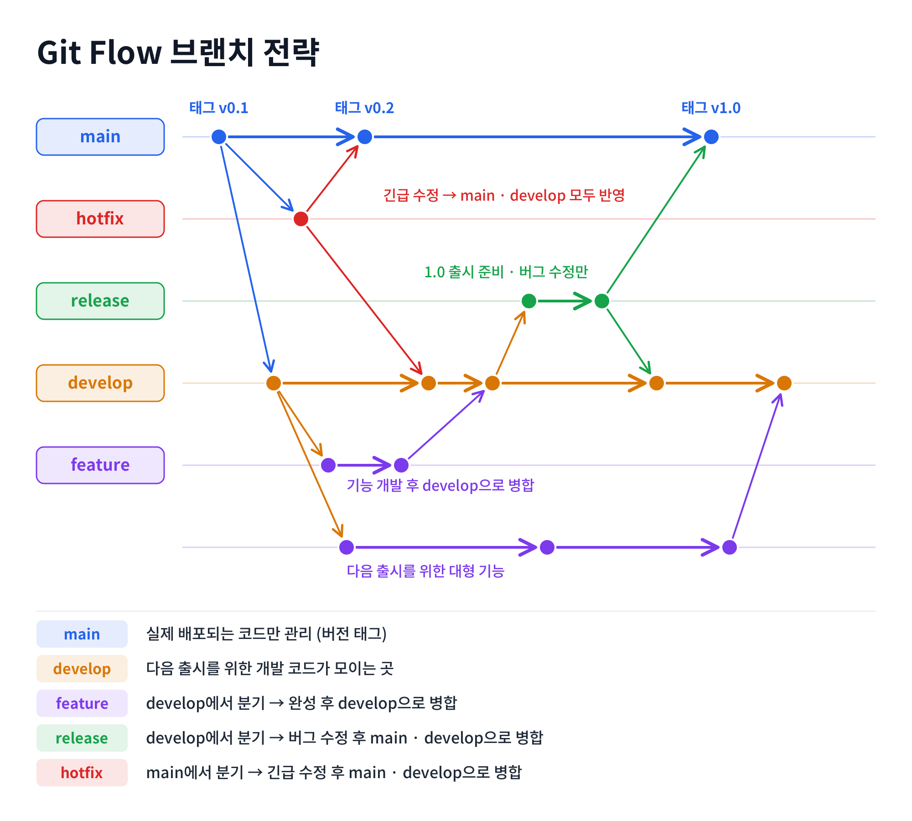

# Git 브랜치 전략 비교: Git Flow와 GitHub Flow

## 1. Git Flow

### 1.1 개념

Git Flow는 Vincent Driessen이 2010년에 소개한 브랜치 모델로, **개발·출시 준비·긴급 수정**을 분리하여 관리한다. 장기간 유지되는 `main`과 `develop`, 작업에 따라 생성하는 `feature/*`, `release/*`, `hotfix/*`가 핵심이다. 정기적인 릴리스 및 별도 검증 단계가 필요한 프로젝트에 적합하다.

### 1.2 브랜치 5종류

| 브랜치 | 역할 | 일반적인 분기·병합 흐름 |
|---|---|---|
| `main` | 배포·출시 기준 코드 및 버전 태그 관리 | `release`·`hotfix` 결과 반영 |
| `develop` | 다음 출시를 위한 기능 통합 | `feature` 작업을 받아 통합 |
| `feature/*` | 개별 기능 개발 | `develop`에서 분기 → 완료 후 `develop` 병합 |
| `release/*` | 출시 전 테스트·결함 수정·문서 정리 | `develop`에서 분기 → `main`과 `develop`에 반영 |
| `hotfix/*` | 출시된 버전의 긴급 오류 수정 | `main`에서 분기 → `main`과 `develop`에 반영 |

**팀원 제공 Git Flow 그림**



### 1.3 일반적인 흐름

1. `develop`에서 `feature/기능명`을 분기해 기능을 개발한다.
2. 완료한 기능을 `develop`에 병합한다.
3. 출시가 가까워지면 `release/버전`을 만들고 테스트·수정한다.
4. 출시 준비가 완료되면 `release`를 `main`에 병합하고 버전 태그를 붙이며, 수정 사항을 `develop`에도 반영한다.
5. 운영 버전에 긴급 오류가 생기면 `main`에서 `hotfix`를 만들고 수정 후 `main`과 `develop`에 반영한다.

### 1.4 장점과 단점

| 장점 | 설명 |
|---|---|
| 역할별 체계적 관리 | 각 브랜치의 목적이 분명하여 개발·출시 흐름을 구분하기 쉽다. |
| 출시 안정성 | 출시 전 별도 테스트 및 버그 수정 단계를 둔다. |
| 협업 및 통합 관리 | 여러 기능을 `develop`에 모아 통합한다. |
| 긴급 오류 대응 | `hotfix` 경로로 배포 버전 문제를 신속히 수정할 수 있다. |

| 단점 | 설명 |
|---|---|
| 운영 복잡도 | 브랜치 종류와 병합 대상이 많아 관리 부담이 크다. |
| 학습 비용 | 기능·릴리스·긴급수정 절차를 이해해야 한다. |
| 단계 증가 | 여러 번의 병합과 검증이 필요해 작업 속도가 느려질 수 있다. |
| 소규모 과제에 과한 절차 | 단순한 프로젝트에는 출시 관리 구조가 불필요할 수 있다. |

### 1.5 사용 사례

- 정기적으로 버전을 배포하는 프로그램 및 패키지 소프트웨어
- 배포 전 테스트와 승인이 엄격한 서비스
- 운영 버전 긴급 수정과 다음 버전 개발을 구분해야 하는 프로젝트
- 모바일 앱 등 릴리스 주기를 따로 관리하는 프로젝트

## 2. GitHub Flow

### 2.1 개념

GitHub Flow는 `main`을 기준으로 **작업별 브랜치를 생성하고 Pull Request(PR)를 통해 검토·병합**하는 비교적 단순한 협업 전략이다. Git Flow와 달리 `develop`, `release` 같은 브랜치를 반드시 운영하지 않는다. `main`은 안정적인 상태를 유지하도록 리뷰와 테스트를 거친 변경만 병합하는 것이 바람직하다.

주요 특징은 `main` 중심 운영, 짧게 유지하는 작업 브랜치, PR 기반 리뷰, 작은 단위의 빠른 통합이다. `feature/`라는 접두사는 관례적인 예시이며 필수 규칙은 아니다.

### 2.2 작업 흐름

```text
main 최신화 → 작업 브랜치 생성 → 기능 개발·로컬 테스트
→ Add·Commit → Push → Pull Request 생성 → Review·수정
→ 테스트 확인 → main에 Merge → 작업 브랜치 정리
```

**① 최신 main에서 브랜치 생성**

```bash
git switch main
git pull origin main
git switch -c feature/user-api
```

**② 기능 개발과 로컬 테스트**

작업 브랜치에서 담당 API를 구현하고 FastAPI Swagger UI(`http://127.0.0.1:8000/docs`)에서 동작을 확인한다.

**③ 변경 사항 기록·업로드**

```bash
git status
git add app/apis/practice_apis.py
git commit -m "feat: 사용자 조회 API 추가"
git push -u origin feature/user-api
```

**④ PR 생성**: GitHub에서 `feature/user-api` → `main`으로 PR을 만들고 기능 및 테스트 내용을 기재한다.

**⑤ Review**: 팀원이 코드를 검토하고 의견을 남긴다. 필요 시 수정 커밋을 추가로 Push한다.

**⑥ Merge**: 리뷰·테스트 및 충돌 확인 후 `main`에 병합한다.

**⑦ 정리**: 병합된 작업 브랜치를 삭제해 목록을 관리한다. 병합된 코드와 PR 기록은 유지된다.

### 2.3 GitHub Flow의 장점

| 장점 | 설명 |
|---|---|
| 단순한 구조 | `main`과 작업 브랜치 중심이라 이해 및 운영이 쉽다. |
| 빠른 통합 | 별도 릴리스 브랜치 없이 작은 변경을 신속히 통합할 수 있다. |
| 코드 리뷰 문화 | PR을 통해 변경 사항에 대한 논의와 검토 기록을 남길 수 있다. |
| 자동화 연계 | GitHub Actions 등 CI 검사와 PR을 연결할 수 있다. |
| 이력 추적 | Issue·Commit·PR을 연계해 변경의 이유를 확인할 수 있다. |
| 충돌 위험 완화 | 브랜치를 짧게 유지하면 기준 코드와의 차이가 커지는 것을 줄일 수 있다. 단, 충돌을 완전히 없애지는 못한다. |

### 2.4 GitHub Flow의 단점과 대응

| 단점/한계 | 대응 방법 |
|---|---|
| `main` 품질 관리가 중요함 | 리뷰·테스트 후 병합하고, 가능하면 보호 규칙 적용 |
| 여러 출시 버전의 동시 관리가 불편함 | 버전 태그·GitHub Releases 활용, 필요하면 다른 전략 검토 |
| 같은 파일을 동시에 수정하면 충돌 발생 | 함수별 업무 분담, 최신 `main` 반영, 순차 병합 |
| 리뷰 대기가 쌓이면 진행 지연 | 리뷰 담당자와 리뷰 순서를 미리 지정 |
| 엄격한 릴리스 절차를 직접 설계해야 함 | 출시 계획과 테스트 절차를 별도로 문서화 |

### 2.5 활용 사례

1. **개인 프로젝트**: 기능별 브랜치에서 작업하고 PR로 수정 내역을 남긴다.
2. **팀 개발**: 역할별로 작업 브랜치를 생성하고 PR 리뷰를 거쳐 병합한다.
3. **테스트 자동화**: PR에 대해 GitHub Actions 검사 후 병합한다. (자동화 구성 시)
4. **Issue 중심 개발**: Issue 번호와 PR을 연결하고, 병합 시 해당 Issue를 종료하도록 설정할 수 있다.
5. **웹 서비스·SaaS**: 하나의 최신 버전을 빠르게 개선하고 배포하는 환경에 잘 맞는다.

### 2.6 협업 시 알아두면 좋은 설정

- **PR 리뷰 유형**: `Comment`(의견), `Approve`(승인), `Request changes`(수정 요청)
- **병합 방식**: `Create a merge commit`(개별 이력 보존), `Squash and merge`(커밋 압축), `Rebase and merge`(선형 이력)
- **선택적 자동화**: GitHub Actions CI, Issue 연계, Ruleset/브랜치 보호 규칙
- 보호 규칙과 기능의 이용 가능 여부는 저장소 설정 및 계정·조직 조건에 따라 확인해야 한다.

## 3. Git Flow vs GitHub Flow 비교

| 구분 | Git Flow | GitHub Flow |
|---|---|---|
| 기본 구조 | `main`·`develop` + `feature`·`release`·`hotfix` | `main` + 기능·수정별 작업 브랜치 |
| 기능 완료 후 병합 | 주로 `develop` | PR로 `main` |
| 출시 준비 | 별도 `release` 흐름 | 필수 릴리스 브랜치 없음 |
| 긴급 수정 | `hotfix` 경로 사용 | 일반 작업 브랜치와 PR 절차 활용 가능 |
| 장점 | 출시와 개발 단계의 명확한 분리 | 단순함, 빠른 통합과 리뷰 |
| 단점 | 운영 및 학습 부담 | 기준 브랜치 품질 관리가 특히 중요 |
| 적합한 환경 | 정기 릴리스·엄격한 출시 관리 | 소규모 팀·지속적 통합 및 배포 |

## 4. 우리 팀 과제 적용 방안

### 4.1 전략 제안: GitHub Flow (팀 결정 전)

**권장안은 GitHub Flow**이다. 이번 과제는 4인 팀이 FastAPI 기능을 나누어 구현하고 `브랜치 생성 → 개발 → Push → PR → Review → Merge`를 실제로 경험하는 것이 핵심이다. 별도의 출시 버전을 관리하지 않으므로 브랜치 수가 적은 방식이 이해와 실행에 유리하다.

다만 `develop` 단계도 경험해보고 싶다면 Git Flow를 선택할 수 있다. **최종 채택 여부는 팀원 논의 후 이 항목을 수정한다.**

### 4.2 추천 작업 순서

1. 팀원들의 조사 내용을 이 문서 하나로 통합해 `docs/2일차_git_branch_전략.md`로 `main`에 반영한다.
2. 브랜치 전략을 팀원들과 확정하고 이 문서의 4.1을 수정한다.
3. 팀장 또는 담당자가 `app/apis/practice_apis.py`에 `router = APIRouter()`를 만들고 `app/main.py`에 라우터 등록을 완료한다.
4. 나머지 팀원은 공통 구조를 최신화한 뒤 `feature/user-api`처럼 개별 브랜치에서 담당 API를 개발한다.
5. 개인별 Swagger UI 테스트 후 Commit·Push·PR을 생성하고, 팀원이 리뷰한다.
6. PR을 하나씩 병합하며 충돌을 해결한다. 마지막에 전원이 최신 코드를 받아 전체 API를 테스트한다.


### 4.3 GitHub Flow 병합 전 최신 코드 반영 예시

```bash
git switch feature/user-api
git fetch origin
git merge origin/main
```

충돌이 발생하면 충돌 표시를 직접 정리하고 테스트한 뒤 커밋·푸시한다. `main`에 강제 Push하지 않는다.

### 4.4 학습·협업 체크리스트

- [ ] Git Flow / GitHub Flow 개념과 비교 정리
- [ ] 팀의 최종 전략 결정과 선정 이유 문서 반영
- [ ] 최종 MD 문서가 원격 저장소 `main`의 `docs/`에 존재
- [ ] 각자 작업 브랜치 생성
- [ ] FastAPI API 구현 및 Swagger UI 테스트
- [ ] Commit / Push / PR / Review / Merge 기록 확인
- [ ] `main` 또는 `develop`에 병합된 최종 API 통합 테스트

## 5. 참고자료

### 한국어 문서 및 포스팅

- [GitHub 공식 문서: GitHub Flow](https://docs.github.com/ko/get-started/using-github/github-flow)
- [HEROPY.DEV: 사례로 이해하는 GitHub Flow](https://www.heropy.dev/p/6hdJi6)
- [AWS: GitHub Flow 분기 전략](https://docs.aws.amazon.com/ko_kr/prescriptive-guidance/latest/choosing-git-branch-approach/github-flow-branching-strategy.html)
- [SK Devocean: Git Branch 전략 비교](https://devocean.sk.com/blog/techBoardDetail.do?ID=165571&boardType=techBlog)
- [Velog: 주니어 개발자의 현업에서 배운 Git Flow](https://velog.io/@myoungji-kim/git-flow)

### 원전

- [Vincent Driessen: A successful Git branching model (Git Flow)](https://nvie.com/posts/a-successful-git-branching-model/)

### 팀원 제공 자료 통합 기준

- Git Flow 개념·종류·장단점·사례: Git Flow 관련 MD 자료 2건, 브랜치 전략 이미지 1건
- GitHub Flow 개념·흐름: GitHub Flow 관련 MD 자료 1건
- GitHub Flow 장단점·사례·협업 규칙: GitHub Flow 관련 MD 자료 2건
